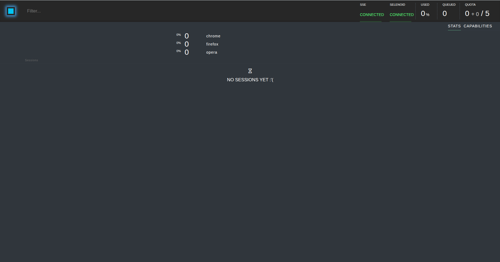
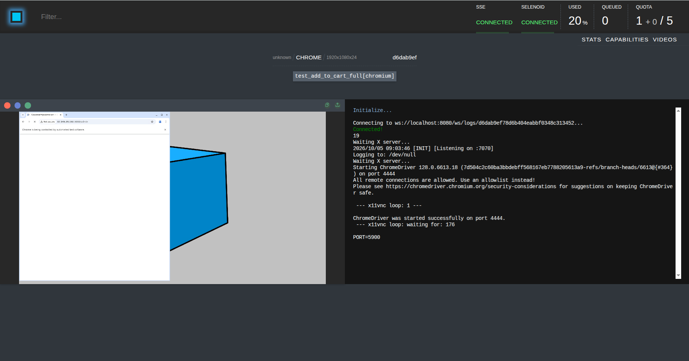

Выбран способ через Configuration Manager, в связи с быстрой и удобной установкой

Доступны следующие браузеры и версии:
```
{
    "chrome": {
        "default": "128.0",
        "versions": {
            "127.0": {
                "image": "selenoid/chrome:127.0",
                "port": "4444",
                "path": "/"
            },
            "128.0": {
                "image": "selenoid/chrome:128.0",
                "port": "4444",
                "path": "/"
            }
        }
    },
    "firefox": {
        "default": "125.0",
        "versions": {
            "124.0": {
                "image": "selenoid/firefox:124.0",
                "port": "4444",
                "path": "/wd/hub"
            },
            "125.0": {
                "image": "selenoid/firefox:125.0",
                "port": "4444",
                "path": "/wd/hub"
            }
        }
    },
    "opera": {
        "default": "109.0",
        "versions": {
            "108.0": {
                "image": "selenoid/opera:108.0",
                "port": "4444",
                "path": "/"
            },
            "109.0": {
                "image": "selenoid/opera:109.0",
                "port": "4444",
                "path": "/"
            }
        }
    }
}
```
Скриншот UI Selenoid:


Скриншот работы Selenoid во время прогона:


Видео лежит на странице на вкладке "Videos" в самом Selenoid. Его можно получить двумя способами:
1. Открыть видео в UI Selenoid
2. Получить видео по ссылке через API

Записывать видео всех тестов является плохой идеей, потому что, слишком быстро будет забиваться память, и будет слишком
много мусорной информации, полезнее будет записывать видео только упавших тестов, чтобы потом узнать, на каком этапе
тест упал, и можно было его починить.
Это можно решить путем проверки "если тест remote и статус теста Failed" -> сохранить видео. 

Локальный запуск: 56.41s
Удаленный запуск: 131.67s(0:02:11)
Selenoid медленнее потому что ему необходимо перед началом теста поднять Docker-контейнер


Локальный браузер стоит использовать для исправления тестов, нет необходимости каждый раз подключаться к удалённому.
Selenoid же стоит использовать для CI/CD, для кроссбраузерного тестирования.

Selenoid в CI будет работать как постоянный docker-контейнер. Когда тесты будут доходить до UI-сценариев, они будут вместо
локального браузера использовать Selenoid. Для упавших тестов Selenoid запишет видео, чтобы можно было их задеббажить.